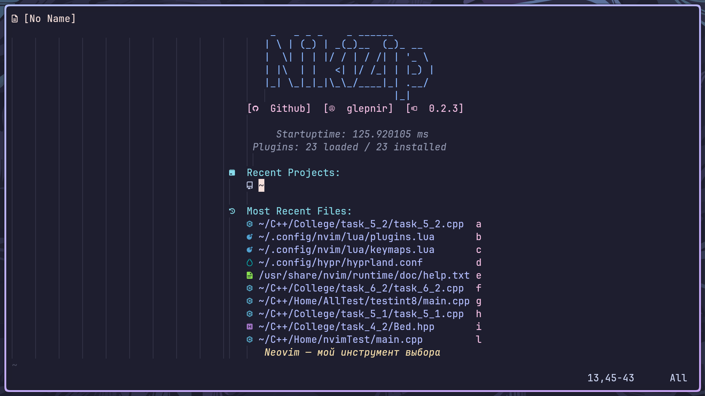
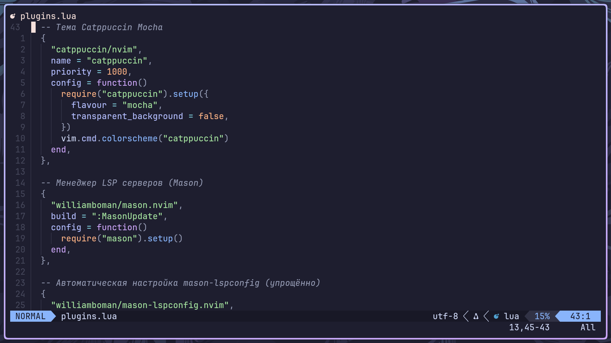
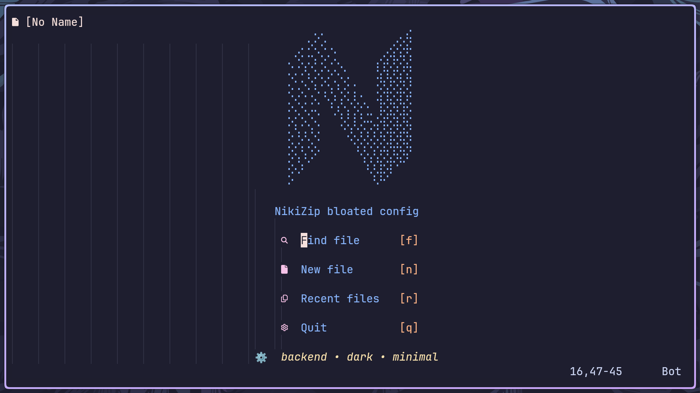

# 🚀 NeoVim-NikiZip

### *Zero-config Neovim distro for C++ / C# / Rust — just code, no tinkering*

[](https://neovim.io/)
[](https://www.lua.org/)
[](https://clangd.llvm.org/)
[](https://github.com/razzmatazz/csharp-language-server)
[](https://rust-analyzer.github.io/)
[](LICENSE)

> **Designed for engineers who want a working IDE out of the box without spending weeks on LSP, completion and formatting configs.**
> Open a `.cpp`, `.cs` or `.rs` file — everything just works.

---

## ✨ What you actually get

| Area | Tools |
|:-----|:------|
| **LSP** | `clangd` (C/C++, `clangd_extensions`), `csharp_ls` (C#, `.sln`/`.csproj` aware), `rust_analyzer` (Rust) — installed by Mason on first launch |
| **Completion** | `nvim-cmp` + `LuaSnip` + friendly-snippets + LSP sources (blink-cmp spec is kept disabled in `lua/plugins/blink.lua`) |
| **Navigation** | `telescope.nvim` — files, live grep, buffers, help (ignores `build/`, `bin/`, `obj/`) |
| **Syntax** | `nvim-treesitter` |
| **Formatting** | `conform.nvim`, format on save: `clang-format` (C/C++), `rustfmt`, `stylua` (Lua), `black` (Python), `gofmt`, `prettier` (web/json/md) |
| **UI** | `Catppuccin` colorschemes + theme picker (`:Tp` / `:ThemePicker` / `<leader>tp`), `lualine`, `neo-tree`, dashboard, indent-blankline, winbar with file icon, `gitsigns`, `neoscroll`, `flash`, `todo-comments` |
| **Reproducibility** | `lazy-lock.json` pinned — everyone gets exact same plugin versions |

<leader> = **space**

## 🖥️ Screenshots

| LSP + completion | Telescope | Dashboard |
|:---:|:---:|:---:|
|  |  |  |

## 📦 Install (one line)

```bash
git clone https://github.com/nikitu0008-collab/NeoVim-NikiZip.git ~/.config/nvim && nvim --headless +"Lazy! sync" +qa
```

Then open any C++/C#/Rust file — Mason will install `clangd` and `csharp_ls` in the background on first launch.

For Rust, install `rust-analyzer` once (or let Mason install it):

```bash
rustup component add rust-analyzer
```

## 🎯 Quick start

**C++ (CMake):**
```bash
cmake -B build -DCMAKE_EXPORT_COMPILE_COMMANDS=ON
nvim src/main.cpp    # clangd picks up compile_commands.json automatically
```

**C# (dotnet):**
```bash
dotnet new console -n MyApp && cd MyApp
nvim Program.cs      # csharp_ls attaches, formatting works
```

**Rust:**
```bash
nvim src/main.rs     # rust_analyzer, rustfmt on save
```

## 🔑 Default key mappings

| Action | Key |
|:-------|:----|
| Find files / live grep | `<leader>ff` / `<leader>fg` |
| Buffers / help tags | `<leader>fb` / `<leader>fh` |
| Go to definition / hover | `gd` / `K` |
| Rename symbol / code actions | `<leader>rn` / `<leader>ca` |
| Format buffer | `<leader>f` (or `<leader>F` via conform) |
| Diagnostics next/prev | `]d` / `[d` |
| Theme picker | `<leader>tp` or `:Tp` |
| Save / quit | `<leader>w` / `<leader>q` |
| Splits: create / navigate | `<leader>sv`, `<leader>sh` / `Ctrl+hjkl` |
| Smoother scroll | `Ctrl+d` / `Ctrl+u` (auto-centered, `neoscroll`) |

## 🔧 Customisation

All modules live in `nvim/lua/plugins/*.lua` — one file per plugin, each returns a lazy.nvim spec:

- Colorschemes — `nvim/lua/plugins/colorscheme.lua` (Catppuccin variants by default)
- LSP servers — `nvim/lua/plugins/lspconfig.lua`
- Mason auto-installs — `nvim/lua/plugins/mason.lua`
- Formatter set — `nvim/lua/plugins/conform.lua`

## 📦 Requirements

| Tool | Version | Why |
|:-----|:--------|:----|
| Neovim | **0.11+** | `vim.lsp.config` / `vim.lsp.enable` API used by `lspconfig.lua` |
| Git | 2.30+ | plugin management (lazy.nvim) |
| ripgrep (`rg`) | any | Telescope live grep (recommended) |
| a Nerd Font | any | pretty icons in lualine / neo-tree (e.g. JetBrainsMono Nerd Font) |

`clangd` and `csharp_ls` are installed by Mason automatically. No other manual setup.

## 🙏 Credits

Built with lazy.nvim, nvim-lspconfig, mason.nvim, nvim-treesitter, telescope.nvim, conform.nvim — and the Neovim community.

## 📄 License

MIT — free to use, modify and share.
